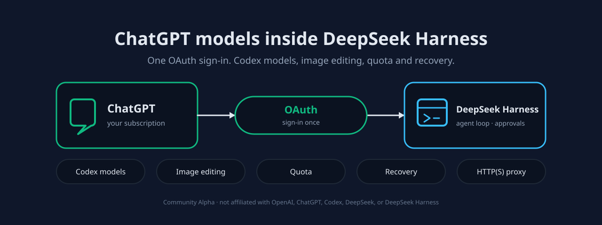

# dsh-chatgpt-connect



**Use the ChatGPT subscription you already pay for, inside DeepSeek Harness.** If you work in Harness but
answer coding questions in another app because your paid models live there, this plugin puts those models
in the normal Harness model picker, so one session keeps the conversation, tools and attachments together.

Apache-2.0 · independent community Alpha · **not affiliated with, sponsored by, or endorsed by** OpenAI,
ChatGPT, Codex, DeepSeek, or DeepSeek Harness. · [Security and permissions](#9-data-permissions-and-privacy) ·
[Uninstall and what it leaves behind](#uninstall-and-what-it-leaves-behind)

English | [中文](docs/README.zh.md)

[](https://www.npmjs.com/package/dsh-chatgpt-connect)
[](LICENSE)
[](package.json)

## 1. What this is and whether it works for you

`dsh-chatgpt-connect` adds one provider, `openai-codex`, to Harness. Harness keeps managing tools,
permissions, approvals, attachments, sessions, compaction and recovery; this plugin only supplies the
model connection and an optional image lane. Installing it does not change your default model or search
route, and it does not turn a ChatGPT subscription into an OpenAI Platform API key.

**Current state.** Published on npm and installable through the `alpha` channel. It runs; it is not a
finished product. See [Install](#3-install).

Four different kinds of limit, stated separately because they need different reactions:

- **Not built.** Ultra orchestration for Codex Sol and a desktop Computer Use executor do not exist here.
- **Built but off by default.** Proxy, search takeover, image viewing, image generation, auto-review and
  the quota tool are all disabled on a fresh install; each is opt-in in the settings panel.
- **Needs permission you may not have.** Model availability, quota and served tier are decided by OpenAI.
  A model in the list is not proof your account may use it.
- **Present but unverified.** The fifteen-host installation matrix is a keyless install and `doctor`
  regression. It does not demonstrate a live OAuth flow, real model calls, real image editing, or a real
  Desktop session.

## 2. What you need before installing

| Requirement | Value |
|---|---|
| DeepSeek Harness | `>=0.1.7-rc.1 <0.3.0`. Inside that range the plugin loads. Whether a given host is reported `compatible` or `unverified` is a separate, recorded verdict — not an admission gate. The current verified list is in [compatibility.json](compatibility.json); this README deliberately does not copy it, so a Harness update inside the range needs no README change. |
| Node.js | `^22.19.0 \|\| >=24.0.0` |
| Account | A ChatGPT account whose subscription can reach the model you want, authorized through the browser during setup |
| Profile | A Harness *profile* is a named configuration (for example `web`). The plugin installs into one profile and only appears there. |

A moving npm tag is not a compatibility guarantee. Do not upgrade or downgrade Harness just to match a row.

## 3. Install

Run this where you normally run Harness, replacing `web` with your profile name:

```sh
dsh plugin --profile web add dsh-chatgpt-connect
```

The plugin loads the next time DSH starts. It does not change your default model or search route; selecting a
model is the next step.

The command names the package, not a version, so publishing does not require editing this file. npm resolves it
through the package's `latest` tag. If your registry is a mirror that lags behind, or you need to pin a version
for a rollout, use the exact command in [INSTALL.md](INSTALL.md). From a DSH source checkout, prefix the command
with `pnpm`.

**Removing it:** see [Uninstall](#uninstall-and-what-it-leaves-behind). Uninstalling does not sign you out
or delete your credentials — that is a separate, deliberate action.

## 4. Quick start: finish one real task

Installation success is not task success. An entry appearing in Settings, or `doctor` passing, only proves
the plugin loaded; it says nothing about whether a model answered. The four steps below end at a real answer.

1. **Input** — a question you actually want answered, typed in a new Harness session (for example: *explain
   what this repository's release workflow does*).
2. **Action** — open the model picker in the composer, choose an `openai-codex` model, and send. If no
   `openai-codex` entry appears, the account is not authorized yet: open **Settings → ANB 工具 →
   ChatGPT Connect → Authorize** and finish the browser approval, then pick the model again.
3. **Where the result appears** — as the normal assistant answer in that session. Tool approvals, file
   changes and attachments behave as they do for any other model.
4. **How to tell it worked** — you got a written answer to your question, with no red error block and no
   `overloaded`/`401`-style diagnostic appended. If instead you get an error, go to
   [Problems and next steps](#7-problems-and-next-steps); if the answer arrives but you want to know what
   the request consumed, see the quota section of the settings panel.

## 5. Daily use

**Main line, end to end.** In DSH, open or create a session → pick an `openai-codex` model in the composer →
work normally (ask, attach files, approve tool calls) → read the answer in the session, where images also land
if you enabled generation.

**Shortest path from the second time on.** Open a session → pick the model → ask. There is no restart and
nothing to re-authorize; the account selection and every toggle persist. If you always want the same model,
your profile's default model covers the picker step, so it collapses to *open a session and ask*.

Things that do change state, so you are not surprised:

- **Account** — choosing another account affects *subsequent* requests, not conversations already started;
  each request keeps the account it captured. There is no automatic rotation or failover.
- **Fast Mode** and per-conversation speed are scoped to one conversation.
- **Attachments and tool calls** are read/written by Harness as usual; this plugin adds no file permissions
  of its own.

## 6. Settings panel

**There is exactly one entry.** The panel title is **ChatGPT Connect**, which does not match the package
name `dsh-chatgpt-connect` — that is the same thing. Path:
**Settings → ANB 工具 → ChatGPT Connect** (Chinese UI: 设置 → ANB 工具 → ChatGPT连接). Everything below lives
inside that one card, including the **More settings** section; there is no separate entry under *Models*.

| Section | What it is for |
|---|---|
| Accounts | Add up to 16 accounts, pick the active one, sign out. |
| Authorize / status | Start the browser OAuth flow and see whether the current account still works. |
| More settings | Every optional capability: proxy, search, image viewing, image generation, auto-review, model catalogue. |
| Diagnostics | Run `doctor` and the capability probes from the UI. |

Every capability toggle with its effect and default:

| Control | Effect when on | Default |
|---|---|---|
| `enableProxy` | Routes this plugin's HTTP(S) traffic — including compressed OAuth and quota responses — through a credential-free proxy. Unrelated Fetch calls keep Harness's transport, and a failed proxy request never retries directly. | **off** |
| `enableSearch` | Makes Codex the search route for the whole profile; turning it off restores the previous route. | **off** |
| `enableImageTool` | Adds `view_image` for local files and validated public HTTP(S) images. | **off** |
| `enableImageGeneration` | Generate images from a prompt, or edit selected conversation images with ordered references. Also bridges image handles to non-Codex routes. | **off** |
| `enableAutoReview` | Sends bounded approval context to `chatgpt.com` for a second opinion; it changes *who reviews*, not what Harness permits. | **off** |
| `enableQuotaTool` | Registers the read-only `codex_connect_quota` tool. Reload the plugin after changing it. | **off** |

**Proxy.** Off by default — this plugin connects directly. To route only this plugin's traffic through an
HTTP(S) proxy: **More settings → Proxy configuration method**, then either **Detect proxy** (scans common
local proxy ports and environment variables without changing the saved connection) or **Configure manually**
and enter a proxy origin with no credentials, path, query or fragment. Press **Test proxy** — activation
requires a **successful test of that exact address**, and the result reports the HTTP status it reached.
Only then can you save, and the panel states what will change ("After saving, ChatGPT Connect will use
<address>"). **Disable proxy** returns to a direct connection. A failed test, or a saved proxy that can no
longer reach the endpoint, leaves you on the direct path — this plugin never retries a failed proxy silently.

Use the image generation capability included with your current GPT subscription. Successful images appear
below the answer in the conversation; generated originals are stored separately from attachment previews, so
disabling the capability or uninstalling the plugin does not delete them.

**Luna Reserve has been removed.** Legacy `enableReserveFallback` settings are ignored; no Reserve
negotiation or automatic model switching remains. Select an ordinary model explicitly for an old
`gpt-reserve` conversation; if Harness cannot change that conversation's model, keep it and start a new one.
Old return files are not read, migrated or deleted.

**Saving.** Change a control, then press **Save changes** at the bottom of the card. A conflict or a failed
save keeps your draft. Volatile capabilities (proxy, auto-review) apply to new requests after saving; the
quota tool needs a plugin reload.

**Two common changes, step by step.**

*Add a second account:* Settings → ANB 工具 → ChatGPT Connect → **Accounts** → **Add account** → complete the
browser approval → the new account appears in the list → select it; later requests use it immediately.

*Turn off auto-review after trying it:* Settings → ANB 工具 → ChatGPT Connect → **More settings** → clear
**Codex Auto-review (Approve for me)** → **Save changes**. Approvals go back to you on the next request;
nothing already approved is re-run.

**When the panel is not visible.** It needs the ANB 工具 shell and a served configuration form. From the
command line, `dsh plugin --profile web exec dsh-chatgpt-connect doctor --json` reports the loaded state; the
raw configuration lives in the profile's plugin configuration, which you can edit by hand and reload.

## 7. Problems and next steps

Use the literal text you see; each row tells you what it means and what to do next.

| What you see | What it means | Next |
|---|---|---|
| No `openai-codex` entry in the model picker | No account authorized, or the plugin is not loaded in this profile | Settings → ANB 工具 → ChatGPT Connect → **Authorize**; then re-check you started the same profile |
| Answer fails with `overloaded` | A service-side condition on that request. It is **not** proof your account is blocked | Retry once; if it persists, compare a request that worked. The bounded diagnostic metadata is attached to the error |
| Answer fails with `401` / re-authorization prompt | The refresh credential was revoked or expired | Authorize again; existing accounts are preserved unless you sign out explicitly |
| A listed model fails while another works | Model entitlement is decided by OpenAI, not by the list | Try a model you have used before; treat the catalogue as advertising, not permission |
| Settings shows the panel but every save conflicts | Another window holds a newer draft | Reload the page, re-apply, save once |
| `doctor` passes but requests still fail | `doctor` is local metadata; it makes no request | Do the [quick start](#4-quick-start-finish-one-real-task) task instead — that is the only real check |

If none of these match, collect the version (`dsh --version` and the plugin version from the panel), the
exact error text, and a minimal reproduction, then use [Feedback](#12-feedback). Remove credentials, tokens,
account identifiers and full session archives before posting.

## 8. Update, roll back, uninstall

| Action | How | What happens to your data |
|---|---|---|
| Update | Install a newer exact version with the same `dsh plugin … add` command | Settings and accounts are kept. Read the changelog first; a version bump does not migrate anything for you |
| Roll back | Install the previous exact version the same way | Settings are kept. A newer setting that the older version does not know is ignored, not deleted |
| Uninstall | `dsh plugin --profile web remove dsh-chatgpt-connect` | The plugin code goes; **credentials and generated images stay** |
| Remove credentials | Settings → ANB 工具 → ChatGPT Connect → **Sign out all accounts**, or run `logout` before uninstalling | Deletes the OAuth state at `$DSH_HOME/.openai-codex-auth.json` |
| Remove generated originals | Delete the image directory yourself; the plugin stores originals separately from attachment previews | Irreversible |

### Uninstall and what it leaves behind

```sh
dsh plugin --profile web remove dsh-chatgpt-connect
```

Uninstalling is **not** a sign-out: the OAuth state file and any generated images remain on disk, because
removing a plugin should not silently destroy data you may still want. If you *do* want it gone, sign out
first (or delete `$DSH_HOME/.openai-codex-auth.json`) and delete the image directory. The plugin never reads
or modifies `~/.codex/auth.json`; that file belongs to a different tool.

## 9. Data, permissions and privacy

- **Reads** — your ChatGPT OAuth credentials for the authorized account; the model catalogue; and, only when
  you enable them, local images you point `view_image` at and the approval context needed for auto-review.
- **Sends off the machine** — requests go to OpenAI at `chatgpt.com` / `api.openai.com`, using the account's
  own credentials. Nothing is sent to the project's maintainers, and there is no telemetry endpoint. If you
  enable a proxy, that proxy is an egress you chose and configure.
- **Writes to disk** — OAuth state at `$DSH_HOME/.openai-codex-auth.json`; generated image originals in the
  session's image directory; nothing else outside Harness's own session files.
- **Who can read it** — the OS account running Harness. The plugin adds no sharing, no server-side store and
  no multi-user access. Treat the auth file as a password.
- **Default switches** — every optional capability is **off** on a fresh install (see the settings table).
  The one thing that is on by default is the network path to OpenAI once you authorize, which is the point
  of the plugin.
- **Credentials in logs** — the plugin's diagnostics report exit codes, allowlisted error codes and version
  strings. It does not print tokens, authorization URLs or account identifiers. Do not paste those into an
  issue yourself.

## 10. Compatibility: required, verified, unconfirmed

- **Required** — a Harness inside `>=0.1.7-rc.1 <0.3.0`, on Node `^22.19.0 || >=24.0.0`.
- **Verified** — this exact release installed and reported `doctor` cleanly on each of the fifteen hosts
  listed in [What you need](#2-what-you-need-before-installing), in the CI installation matrix for release
  `0.3.1-alpha.2`.
- **Not confirmed** — live OAuth against a real account, real model responses, real image generation and
  editing, a real Desktop session, and migrating tasks across a Harness upgrade. Treat those as untested
  for this release.

## 11. Documentation and development

`docs/` is not shipped in the npm package, so those links point at GitHub and stay current there.

- [Installation and upgrades](INSTALL.md) · [Versioning policy](VERSIONING.md) · [Migration from `dsh-codex`](MIGRATION.md)
- [Configuration, diagnostics and recovery](https://github.com/yiyunet/dsh-chatgpt-connect/blob/main/docs/reference.md)
- [Architecture and security details](https://github.com/yiyunet/dsh-chatgpt-connect/blob/main/docs/design.md)
- [Auto-review behaviour](https://github.com/yiyunet/dsh-chatgpt-connect/blob/main/docs/auto-review.md)
- [Chinese README](https://github.com/yiyunet/dsh-chatgpt-connect/blob/main/docs/README.zh.md)

Building from source is a separate path, only for working on the plugin:

```sh
pnpm install --frozen-lockfile
pnpm run check
pnpm run test:browser
pnpm run check:dsh-install
```

`lib/` is a committed build product; rebuild it on Linux, because the same sources produce different bytes
on Windows. See the [release runbook](https://github.com/yiyunet/dsh-chatgpt-connect/blob/main/RELEASING.md).

## 12. Feedback

Open an issue at <https://github.com/yiyunet/dsh-chatgpt-connect/issues>. The minimum useful material is: the
plugin version, the Harness version, the exact error text, and the smallest reproduction you can manage. For
a suspected credential or authorization problem, follow the
[security policy](https://github.com/yiyunet/dsh-chatgpt-connect/blob/main/SECURITY.md) instead of opening a
public issue. Remove tokens, account identifiers and full session archives from anything you post.

## 13. Licence and provenance

Copyright 2026 Frank Song for the original Codex Connect work; Copyright 2026 yiyunet for this fork's
modifications. Distributed under **Apache-2.0** — full text in [LICENSE](LICENSE), notices in [NOTICE](NOTICE).
This project contains software derived from [Yan-Zero/dsh-codex](https://github.com/Yan-Zero/dsh-codex) and
is forked from [franksong2702/dsh-codex-connect](https://github.com/franksong2702/dsh-codex-connect); all
upstream copyrights are retained. It is not affiliated with, sponsored by, or endorsed by OpenAI, ChatGPT,
Codex, DeepSeek, or DeepSeek Harness.

The published artifact carries a SLSA provenance attestation naming the commit and workflow that built it.
