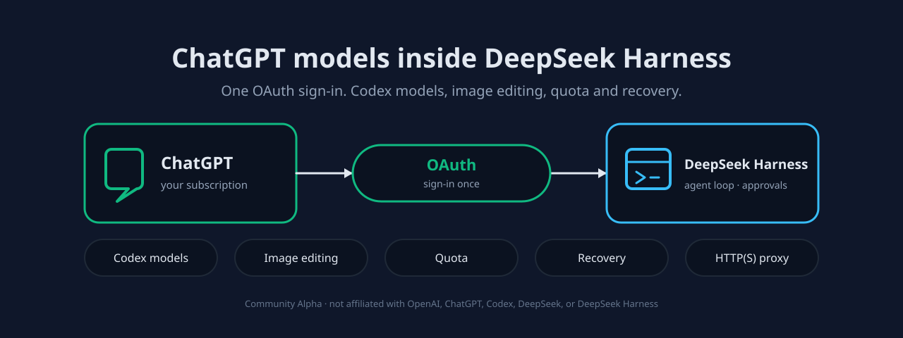

# dsh-chatgpt-connect



**把你已经在付费的 ChatGPT 订阅，用在 DeepSeek Harness 里。** 如果你在 Harness 里干活、却因为付费模型在别处而另开一个应用问问题，
这个插件把那些模型放进 Harness 常规的模型选择器，让同一个会话保留对话、工具与附件。

Apache-2.0 · 独立社区 Alpha · **与 OpenAI、ChatGPT、Codex、DeepSeek、DeepSeek Harness 均无隶属关系**，亦未获其赞助或背书 ·
[安全与权限](#9-数据权限与隐私) · [卸载与残留](#卸载与残留什么)

[English](../README.md) | 中文

[](https://www.npmjs.com/package/dsh-chatgpt-connect)
[](../LICENSE)
[](../package.json)

## 1. 这是什么，适不适合你

`dsh-chatgpt-connect` 只做一件事：往 Harness 里加一个 `openai-codex` 提供方。工具、权限、审批、附件、会话、压缩与恢复继续由
Harness 管理；插件只提供模型连接和一条可选的图片通道。安装它不会改变你的默认模型或搜索路由，也不会把 ChatGPT 订阅变成
OpenAI Platform API Key。

**当前状态。** 已发布到 npm，可通过 `alpha` 渠道安装。能用，但不是成品。见[安装](#3-安装)。

四类限制分开写，因为它们需要完全不同的反应：

- **尚未实现**：Codex Sol 的 Ultra 编排、桌面 Computer Use 执行器，本插件里没有。
- **已实现但默认关闭**：代理、搜索接管、图片查看、图片生成、自动审查、额度工具，全新安装时全部关闭，需在设置面板逐项开启。
- **需要你未必拥有的权限**：模型可用性、额度与服务档位由 OpenAI 决定。模型出现在列表里，不代表你的账户能用它。
- **存在但未验证**：十五个宿主的安装矩阵是**无凭据安装 + `doctor` 回归**，不代表真实 OAuth 流程、真实模型调用、真实图片编辑，
  也不代表真实 Desktop 会话。

## 2. 安装前需要准备什么

| 要求 | 取值 |
|---|---|
| DeepSeek Harness | `>=0.1.7-rc.1 <0.3.0`。区间之内插件即可加载。某个宿主被报告为 `compatible` 还是 `unverified`，是一份**单独记录的判定**，不是准入闸门。当前的已验证清单在 [compatibility.json](../compatibility.json) 里；本 README **刻意不复制**它，因此区间内的 Harness 更新不需要改这份文档。 |
| Node.js | `^22.19.0 \|\| >=24.0.0` |
| 账户 | 一个能访问你所需模型的 ChatGPT 账户，安装过程中通过浏览器完成授权 |
| Profile | Harness 的 *profile* 是一套命名配置（例如 `web`）。插件装进某一个 profile，也只在该 profile 里出现。 |

会移动的 npm tag 不代表兼容性保证。不要为了凑上某一行而升级或降级 Harness。

## 3. 安装

在你平时运行 Harness 的地方执行，把 `web` 换成你的 profile 名：

```sh
dsh plugin --profile web add dsh-chatgpt-connect
```

插件在**DSH 下次启动**时加载。它不会改变你的默认模型或搜索路由 —— 选模型是下一步。

命令里写的是包名而不是版本号，因此发版不需要改这份文档。npm 通过该包的 `latest` 标签解析它。若你的 registry 是滞后于官方的镜像，
或需要在灰度中钉住某个版本，请用 [INSTALL.md](../INSTALL.md) 里的精确命令。从源码检出运行 Harness 时，在命令前加 `pnpm`。

**想撤掉它**：见[卸载与残留](#卸载与残留什么)。卸载**不等于**退出登录，也不会删除凭据 —— 那是另一个需要你明确执行的动作。

## 4. 快速开始：完成一次真实任务

安装成功不等于任务成功。设置里出现入口、或 `doctor` 通过，只能证明插件加载了，无法说明模型是否回答。下面四步的落点是一次真实回答。

1. **给什么输入** —— 一个你确实想得到答案的问题，在新建的 Harness 会话里输入（例如：*讲讲这个仓库的发布工作流做了什么*）。
2. **做什么操作** —— 打开输入框的模型选择器，选一个 `openai-codex` 模型，发送。若选择器里没有 `openai-codex`，说明账户尚未授权：
   打开 **设置 → ANB 工具 → ChatGPT连接 → 授权**，在浏览器完成批准后再选一次模型。
3. **结果出现在哪** —— 就是该会话里正常的助手回答。工具审批、文件改动、附件行为与其他模型一致。
4. **怎样判断符合预期** —— 你得到了针对该问题的文字回答，没有红色错误块，也没有附加 `overloaded` / `401` 一类诊断。
   若报错，去[出问题时怎么办](#7-出问题时怎么办)；若拿到了回答但想知道这次请求消耗了什么，看设置面板里的额度分区。

## 5. 日常使用

**主线，端到端。** 在 DSH 里打开或新建会话 → 在输入框选一个 `openai-codex` 模型 → 正常干活（提问、挂附件、审批工具调用）
→ 在会话里读回答；若开启了图片生成，图片也出现在同一处。

**第二次及以后的最短路径。** 打开会话 → 选模型 → 提问。不需要重启，也不需要重新授权；账户选择与每一个开关都会保留。
若你长期只用同一个模型，把它设成 profile 的默认模型即可省掉选择器那一步，于是整条路径收敛为「开会话，直接问」。

几种**会改变状态**的情况，先说清免得意外：

- **账户** —— 切换账户只影响**后续**请求，不影响已经开始的对话；每个请求保留它捕获时使用的账户。插件不会自动轮换或静默故障切换。
- **Fast Mode** 与单次对话的速度选择是**会话级**的。
- **附件与工具调用**照常由 Harness 读写；插件不额外增加任何文件权限。

## 6. 设置面板

**只有一个入口。** 面板标题是 **ChatGPT Connect**，与包名 `dsh-chatgpt-connect` 不一致 —— 它们指的是同一个东西。路径：
**设置 → ANB 工具 → ChatGPT连接**（英文界面：Settings → ANB 工具 → ChatGPT Connect）。下面全部内容都在这一张卡片里，
包括 **更多设置** 分区；**设置 → 模型** 下没有第二个入口。

| 分区 | 作用 |
|---|---|
| 账户 | 添加最多 16 个账户、选择活动账户、退出登录。 |
| 授权 / 状态 | 发起浏览器 OAuth 流程，并查看当前账户是否仍然可用。 |
| 更多设置 | 全部可选能力：代理、搜索、图片查看、图片生成、自动审查、模型目录。 |
| 诊断 | 在界面里运行 `doctor` 与能力探针。 |

每个能力开关的作用与默认值：

| 控件 | 开启后的效果 | 默认 |
|---|---|---|
| `enableProxy` | 把本插件的 HTTP(S) 流量（含压缩的 OAuth 与额度响应）走一个无凭据代理。无关 Fetch 请求仍用 Harness 自己的传输方式；代理请求失败不会静默改直连。 | **关** |
| `enableSearch` | 把整个 profile 的搜索路由切到 Codex；关闭后恢复之前的路由。 | **关** |
| `enableImageTool` | 为视觉模型添加 `view_image`，读取本地文件与经过校验的公网 HTTP(S) 图片。 | **关** |
| `enableImageGeneration` | 按提示词生图，或编辑选定的会话图片并使用有顺序的参考图。同时把图片句柄桥接到非 Codex 路由。 | **关** |
| `enableAutoReview` | 把有界的审批上下文发送到 `chatgpt.com` 做二次判断；它更换的是**审批者**，不改变 Harness 允许什么。 | **关** |
| `enableQuotaTool` | 注册只读工具 `codex_connect_quota`。改动后需重新加载插件。 | **关** |

**代理。** 默认关闭 —— 插件直连。若要把**仅本插件**的流量走 HTTP(S) 代理：**更多设置 → 代理配置方式**，然后二选一 ——
**检测代理**（扫描本机常见代理端口与环境变量，不改变已保存的连接）或 **手动配置** 并填入一个不含账号、密码、路径、
查询参数或片段的 HTTP(S) 代理 origin。按 **测试代理** —— **启用前必须先对当前这个地址测试成功**，测试结果会报出它到达
Codex 端点时的 HTTP 状态。只有测试通过才能保存，且面板会明说保存后会发生什么（「保存后将使用代理 <地址>」）。
**停用代理** 即回到直连。测试失败、或已保存的代理不再能到达端点时，你会留在直连上 —— 本插件**从不**静默改走直连或静默重试。

使用你当前 GPT 订阅计划提供的图片生成能力。成功生成的图片显示在会话回答下方；生成原文件与附件预览分开保存，
因此关闭该能力或卸载插件都不会删除这些文件。

**Luna Reserve 已移除。** 旧 `enableReserveFallback` 开关会被忽略，不再有 Reserve 协商或自动切换模型。旧 `gpt-reserve` 会话请明确
选择一个普通模型；若 Harness 无法在原会话切换，请保留原会话并另开一个。旧 return 文件原样保留，不读取、迁移或删除。

**保存生效。** 改完控件后按卡片底部的 **保存更改**。发生冲突或保存失败时会保留你的草稿。易变能力（代理、自动审查）保存后对**新请求**生效；
额度工具需要重新加载插件。

**两个最常见的改动，分步操作。**

*添加第二个账户：* 设置 → ANB 工具 → ChatGPT连接 → **账户** → **添加账户** → 在浏览器完成批准 → 新账户出现在列表中 → 选中它，
后续请求立即使用。

*试用后关闭自动审查：* 设置 → ANB 工具 → ChatGPT连接 → **更多设置** → 取消勾选 **Codex 自动审查（代我审批）** → **保存更改**。
下一个请求起审批回到你手上；已经批准过的动作不会被重跑。

**面板看不见时。** 它依赖 ANB 工具壳与可用的配置表单。命令行下可执行
`dsh plugin --profile web exec dsh-chatgpt-connect doctor --json` 查看加载状态；原始配置位于该 profile 的插件配置中，可手工编辑后重新加载。

## 7. 出问题时怎么办

下面用你实际会看到的原文症状；每一行给出含义与下一步。

| 你看到什么 | 含义 | 下一步 |
|---|---|---|
| 模型选择器里没有 `openai-codex` | 还没有账户授权，或插件没在该 profile 加载 | 设置 → ANB 工具 → ChatGPT连接 → **授权**；再确认你启动的是同一个 profile |
| 回答报 `overloaded` | 该次请求遇到服务端状况，**不代表**你的账户被封 | 重试一次；若持续，与一次成功的请求做对照。有界诊断信息附在错误里 |
| 回答报 `401` / 提示重新授权 | 刷新凭据被撤销或过期 | 重新授权；除非你显式退出，已有账户会保留 |
| 某个列表中的模型失败、另一个正常 | 模型权限由 OpenAI 决定，不由列表决定 | 换一个你以前用过的模型；把目录当广告看，不当权限 |
| 面板能打开但每次保存都冲突 | 另一个窗口持有更新的草稿 | 刷新页面，重新修改，再保存一次 |
| `doctor` 通过但请求仍失败 | `doctor` 只读本地元数据，不发请求 | 改做[快速开始](#4-快速开始完成一次真实任务)里的任务 —— 那才是唯一真实的检查 |

都不匹配时，请收齐版本（`dsh --version` 与面板里的插件版本）、错误原文、最小复现，再到[反馈](#12-反馈)提。提交前请移除凭据、
token、账户标识与完整会话归档。

## 8. 更新、回滚、卸载

| 动作 | 怎么做 | 你的数据会怎样 |
|---|---|---|
| 更新 | 用同一条 `dsh plugin … add` 命令安装更新的精确版本 | 设置与账户保留。先读变更记录；升版本不会替你迁移任何东西 |
| 回滚 | 用同样方式安装上一个精确版本 | 设置保留。旧版本不认识的新设置会被忽略，不会被删除 |
| 卸载 | `dsh plugin --profile web remove dsh-chatgpt-connect` | 插件代码移除；**凭据与已生成图片保留** |
| 删除凭据 | 设置 → ANB 工具 → ChatGPT连接 → **退出所有账户**，或卸载前执行 `logout` | 删除 `$DSH_HOME/.openai-codex-auth.json` 中的 OAuth 状态 |
| 删除生成原图 | 自行删除图片目录；插件把原文件与附件预览分开存放 | 不可恢复 |

### 卸载与残留什么

```sh
dsh plugin --profile web remove dsh-chatgpt-connect
```

卸载**不是**退出登录：OAuth 状态文件与已生成的图片仍留在磁盘上，因为移除一个插件不该静默销毁你可能还需要的数据。
若你确实要一起清掉，先退出登录（或删除 `$DSH_HOME/.openai-codex-auth.json`），再删除图片目录。插件从不读取或修改
`~/.codex/auth.json`，那是另一个工具的文件。

## 9. 数据、权限与隐私

- **读什么** —— 已授权账户的 ChatGPT OAuth 凭据；模型目录；以及仅在你开启时才读取的本机图片（`view_image` 指向的文件）与
  自动审查所需的审批上下文。
- **是否外发及目标域名** —— 请求发往 OpenAI 的 `chatgpt.com` / `api.openai.com`，使用账户自己的凭据。**不向本项目维护者发送任何数据，
  也没有遥测端点。** 若你启用代理，那个代理是你自己选择的出口。
- **是否落盘及位置** —— OAuth 状态在 `$DSH_HOME/.openai-codex-auth.json`；生成的原图在会话图片目录；除此之外不写 Harness 会话文件以外的地方。
- **谁可读写** —— 只有运行 Harness 的那个操作系统账户。插件不提供共享、无服务端存储、无多用户访问。请把该凭据文件当作密码对待。
- **关键默认开关** —— 所有可选能力在全新安装时**全部关闭**（见设置表）。默认唯一打开的是授权后通往 OpenAI 的网络通路，那也是插件存在的意义。
- **凭据存哪、是否进日志** —— 凭据只存在上述文件里。插件的诊断只输出退出码、允许清单内的错误码与版本字符串，**不打印 token、授权 URL
  或账户标识**。也请不要自己把这些贴进 issue。

## 10. 兼容性：要求、已验证、仍未确认

- **要求** —— Harness 处于 `>=0.1.7-rc.1 <0.3.0`，Node `^22.19.0 || >=24.0.0`。
- **已验证** —— 该精确版本在[安装前需要准备什么](#2-安装前需要准备什么)所列十五个宿主上完成安装并 `doctor` 干净，证据是
  `0.3.1-alpha.2` 的 CI 安装矩阵。
- **仍未确认** —— 真实账户的 OAuth 流程、真实模型回答、真实图片生成与编辑、真实 Desktop 会话，以及跨 Harness 升级迁移旧任务。
  本版本请把它们当作未测。

## 11. 文档与开发

`docs/` 不随 npm 包发布，因此这些链接指向仓库，在那里始终最新。

- [安装与升级](../INSTALL.md) · [版本策略](../VERSIONING.md) · [从 `dsh-codex` 迁移](../MIGRATION.md)
- [配置、诊断与恢复](reference.zh.md)
- [架构与安全细节](design.zh.md)
- [自动审查行为](auto-review.zh.md)
- [英文 README](../README.md)

从源码构建是另一条路径，只在需要改插件时用：

```sh
pnpm install --frozen-lockfile
pnpm run check
pnpm run test:browser
pnpm run check:dsh-install
```

`lib/` 是入库的构建产物；请在 Linux 上重建，因为同一份源码在 Windows 上会产出不同字节。详见
[发布运行手册](../RELEASING.md)。

## 12. 反馈

在 <https://github.com/yiyunet/dsh-chatgpt-connect/issues> 提 issue。最小有用材料是：插件版本、Harness 版本、错误原文、
你能做到的最小复现。怀疑凭据或授权出问题时，改走[安全政策](../SECURITY.md)，不要开公开 issue。任何提交前请移除 token、
账户标识与完整会话归档。

## 13. 许可与来源

Codex Connect 原始工作 Copyright 2026 Frank Song；本分支的修改 Copyright 2026 yiyunet。以 **Apache-2.0** 发布 ——
全文见 [LICENSE](../LICENSE)，声明见 [NOTICE](../NOTICE)。本项目包含派生自
[Yan-Zero/dsh-codex](https://github.com/Yan-Zero/dsh-codex) 的软件，并 fork 自
[franksong2702/dsh-codex-connect](https://github.com/franksong2702/dsh-codex-connect)；所有上游版权均予保留。
与 OpenAI、ChatGPT、Codex、DeepSeek、DeepSeek Harness 均无隶属关系，亦未获其赞助或背书。

已发布的包带有 SLSA provenance 存证，记录构建它的提交与 workflow。
